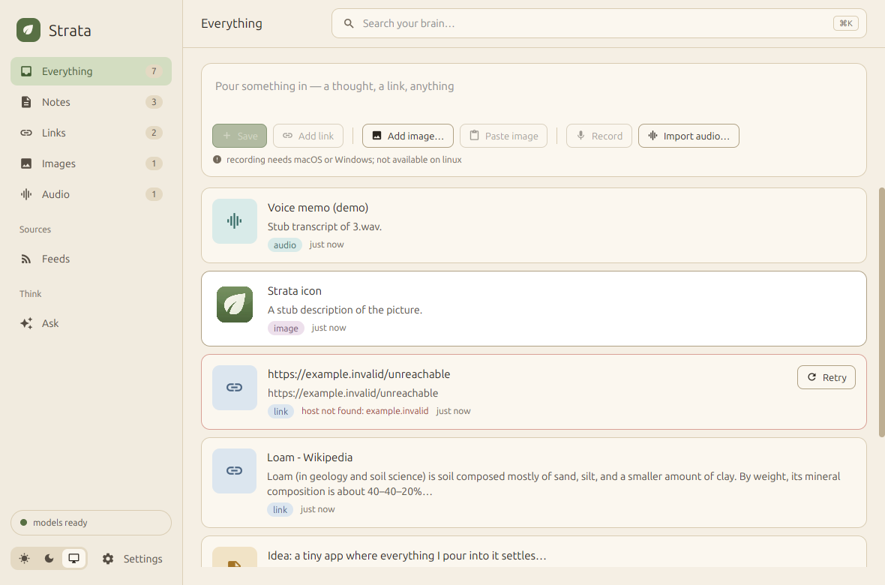

# Strata



Strata is a second brain that lives on your computer. Drop in anything you want to keep:
notes, links, images, voice memos, RSS feeds. All of it becomes searchable by meaning, by
keyword and by what is in a picture. Then ask questions about what you have saved, and Strata
answers with citations back to the items it used.

Everything runs locally. Search, transcription and image understanding use small models on your
own machine. The model that answers your questions is Gemma 4 E4B on your GPU by default, or any
OpenAI-compatible endpoint you point it at, such as Ollama, LM Studio or OpenAI.

Strata is a real native app, not a web view. It is written in Svelte and drawn by GPUI, the
GPU-accelerated UI framework behind the Zed editor, through
[gpuix-svelte](https://github.com/khromov/gpuix-svelte). It started life as one of
gpuix-svelte's examples.

## Getting started

You need [Bun](https://bun.sh) 1.4.3 or newer. Strata relies on Bun's built-in SQLite, image,
HTML and FFI APIs, so it does not run on Node.

```bash
git clone https://github.com/khromov/strata-gpuix-svelte
cd strata-gpuix-svelte
bun install
bun run ml:install   # once: the on-device model dependencies, about 380 MB
bun run start
```

The first launch downloads three small models (about 380 MB) into `.data/models` and shows
progress in the status pill. You can start adding things right away, and keyword search works
while the download runs. If you skip `ml:install`, Strata still opens and keyword search still
works. The Models panel in Settings tells you what to run.

On Linux, `bun run start:wayland` or `bun run start:x11` picks the window system by hand.

## What you can do

**Capture anything.** Type a note (Enter saves, Shift+Enter adds a line). Paste a URL and Strata
fetches the page, keeps the readable text, and saves the title and preview image. Add images from
the file chooser or straight from the clipboard. Record a voice memo with the microphone (macOS
and Windows), or import a WAV or MP3. Audio is transcribed and images are described, so both turn
up in search.

**Search three ways at once.** One search box matches by meaning, by keyword and by what is in an
image. Each result shows which of those found it, and an image found by its content gets a
"visual match" badge. Type `kind:note`, `kind:link`, `kind:image` or `kind:audio` to narrow a
search, with completions as you type. Paste a URL to jump to its item. Every item also has a
Related list.

**Follow feeds.** Subscribe to an RSS or Atom feed, or just a blog's homepage, and new entries are
saved like any other link. Each feed has its own check interval, a switch for fetching the full
article, and optional retention rules. Anything you have edited is never pruned. Because feeds
bring in far more than you do, one "Include feeds" switch decides whether their entries show up
in the timeline, search, Ask and Related. It is on by default, appears wherever it matters, and
`feeds:on` in a query overrides it once.

**Ask.** Ask a question and Strata answers from what you have saved, streaming the reply as
markdown with numbered citations. Click a citation to open the item. Settings → Language model
chooses who answers:

- **On this computer** (the default). Gemma 4 E4B through transformers.js on WebGPU. The first
  question downloads it (about 5.2 GB, with progress shown in the chat and the status pill). It
  uses about 6 GB of memory while loaded and shuts itself down after ten idle minutes. It also
  reads images, so every imported image gets a description.
- **An OpenAI-compatible endpoint.** Ollama, LM Studio, OpenAI, OpenRouter and the like. If the
  model can see images, it describes them on import.

**Right-click anything.** Items, feeds, sidebar entries, answers, citations and empty space each
have a menu with the actions that apply to them. The arrow keys and Enter work through it, and
anything destructive asks first.

**Light and dark.** Follows your system, or fix it in Settings.

**See what is happening.** Settings → Pipeline shows what is being scraped, transcribed and
embedded right now, with retry buttons. Settings → On-device models shows each model's state,
download progress and memory use.

## Your data

Everything lives in one file, `strata.sqlite`, inside the `.data` directory (or the OS's
application data directory for the built app: `~/Library/Application Support/Strata`,
`%APPDATA%\Strata` or `~/.local/share/strata`). Images, thumbnails and
recordings are stored inside it, so copying that one file copies your whole brain. The `cache`
directory beside it is disposable and rebuilds itself.

An API key entered in Settings is stored in plain text in that file. Set `GPUIX_BRAIN_LLM_KEY`
instead if you would rather it never touches disk.

## Building

```bash
bun run build   # the app for this machine, ML dependencies and all, archived under dist/
```

On macOS that is `dist/Strata.app`, zipped; on Linux and Windows a `strata-<os>-<arch>`
directory with the executable and a `resources` directory beside it, as `.tar.gz` or `.zip`.
Each archive is about 110 MB. Set `CODESIGN_IDENTITY` and `NOTARY_PROFILE` on macOS to sign
and notarize. [docs/internals.md](docs/internals.md#the-compiled-app) explains how it is put
together.

Releases are cut by [release-please](https://github.com/googleapis/release-please): merging
the release PR it keeps open on `main` tags a version, and the `release` workflow builds
macOS arm64, Linux x64, Windows x64 and Windows arm64 and attaches them to the GitHub release.

## Configuration

All optional, all prefixed `GPUIX_BRAIN_`:

| Variable | Effect |
|---|---|
| `DIR` | data directory (default `.data`, or the app data directory when compiled) |
| `STUB=1` | seeded fake data and a stub worker, no models; used for screenshots and tests |
| `START=/settings` | initial route |
| `THEME=light\|dark` | ignore the stored theme and the system setting |
| `ML=off` | disable the ML worker entirely |
| `OFFLINE=1` | never download models |
| `RECORDER=0` | don't load the microphone backend (nor compile the shim, on macOS) |
| `FEEDS=0` | no scheduled feed polling (manual refresh still works); implied by `OFFLINE=1` |
| `LLM_PROVIDER=local\|openai` | override the Language model choice in Settings |
| `LLM_URL`, `LLM_KEY`, `LLM_MODEL` | override Settings; the key never has to be stored |
| `GEMMA_URL` | where Gemma's files download from instead of Strata's mirror (`<url>/config.json`, `<url>/onnx/…`; the list is `GEMMA_FILES` in `lib/llm-local.ts`) |
| `RESOURCES=/path` | where a compiled app's worker and shim live (auto-detected inside a .app) |
| `DEBUG=1` | verbose logging |

`GPUIX_SCREENSHOT=/tmp/x.png` and `GPUIX_FPS=1` (GPUI's draw-time overlay) work as in any
gpuix-svelte app.

## For developers

```bash
bun run test        # data and native tests, then a headless UI smoke test; no models, no network
bun run typecheck   # tsc, then svelte-check against GPUI's element types
bun run ml:doctor   # loads each model under Bun and runs one inference
bun run import-hn   # pours today's Hacker News front page in
bun run seed-load   # a 5000-item load-test brain in .data/load, beside the real one
bun run frames      # GPUI draw times per route, against a copy of the data
```

[docs/internals.md](docs/internals.md) covers how the code is laid out, how the data and model
processes fit together, the memory safeguards, what stands in for the APIs GPUI does not have
(microphone, clipboard, file picker, audio playback), and why Strata has its own router.
[AGENTS.md](AGENTS.md) is the guide for contributors and coding agents.
